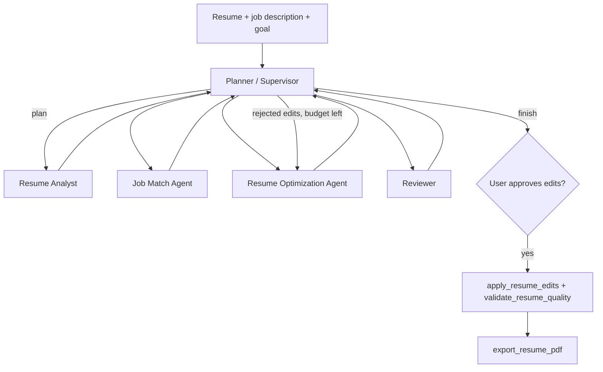

# GapWise AI 🎯

> **RAG & AI-powered interview preparation platform** — upload your resume, paste the job description, and get a personalized interview report, predicted questions, skill gap analysis, and a tailored resume PDF in seconds.


---

## ✨ Features

- 🔐 **JWT Authentication System**
- 📄 **Resume Upload and PDF Parsing**
- 🧠 **RAG-Powered Resume Matching Pipeline**
- 🤖 **AI Interview Report Generation (Gemini + Zod schema)**
- 🤖 **AI Interview Report Generation (Zod schema)**
- 📊 **Match Score Normalization and Skill Gap Analysis**
- 💬 **Technical and Behavioral Questions with intent and answer guidance**
- 📅 **Personalized Preparation Roadmap**
- 🧭 **Agentic Resume Optimizer (5 LangGraph agents, 8 tools, human approval before any change)**
- 📥 **ATS-Friendly Resume PDF Generator**
- 🪟 **Windows-safe PDF generation fallback (local Chrome/Edge support)**
- 📚 **Interview Report History**
- 🐳 **Dockerized Full Stack Application**
- ⚙️ **GitHub Actions CI/CD Pipeline**
- 🧪 **Automated API Testing with Jest and Supertest**

---

## 🛠️ Tech Stack

### Backend

| Technology                         | Purpose                                     |
| ---------------------------------- | ------------------------------------------- |
| Node.js + Express                  | REST API server                             |
| MongoDB + Mongoose                 | Database                                    |
| JWT + bcryptjs                     | Authentication                              |
| Google Gemini AI via @google/genai | Interview report and resume HTML generation |
| Local RAG service                  | Resume chunking, embedding, retrieval       |
| Puppeteer Core + Chromium          | HTML to PDF conversion                      |
| Multer                             | Resume upload handling                      |
| pdf-parse                          | PDF text extraction                         |
| Zod + zod-to-json-schema           | AI output schema enforcement                |
| Jest + Supertest                   | API tests                                   |

### Frontend

| Technology      | Purpose            |
| --------------- | ------------------ |
| React 19 + Vite | Frontend framework |
| React Router v7 | Routing            |
| Axios           | API requests       |
| SASS            | Styling            |

### DevOps and Deployment

| Technology     | Purpose                       |
| -------------- | ----------------------------- |
| Docker         | Containerization              |
| Docker Compose | Multi-container orchestration |
| GitHub Actions | CI/CD automation              |
| Nginx          | Frontend production server    |
| Render         | Deployment platform           |

---

## 🚀 Local Development Setup

### Prerequisites

- Node.js >= 18
- Docker and Docker Compose
- MongoDB Atlas account or local MongoDB
- Google Gemini API key
- Pinecone account and API key

---

### 1. Clone Repository

```bash
git clone https://github.com/Akshay4754/GapWiseAI.git
cd GapWiseAI
```

---

### 2. Backend Setup

```bash
cd Backend
npm install
```

Create .env inside Backend/

```env
PORT=3000
MONGO_URI=your_mongodb_connection_string
JWT_SECRET=your_jwt_secret
GOOGLE_GENAI_API_KEY=your_gemini_api_key
PINECONE_API_KEY=your_pinecone_api_key
PINECONE_INDEX_NAME=gapwise-ai-rag-google
GOOGLE_EMBEDDING_MODEL=gemini-embedding-001
GOOGLE_EMBEDDING_DIMENSIONS=768
FRONTEND_ORIGIN=http://localhost:5173,http://localhost:5174
```

Run backend

```bash
npm run dev
```

If `npm run dev` has trouble with `nodemon`, run:

```bash
npm start
```

---

### 3. Frontend Setup

```bash
cd Frontend
npm install
```

Create .env inside Frontend/

```env
VITE_API_URL=http://localhost:3000
```

Run frontend

```bash
npm run dev
```

Frontend runs at

```bash
http://localhost:5173
```

---

## 🐳 Docker Setup

### Run Full Application

```bash
docker-compose up --build
```

Containers expose

- Frontend on http://localhost:3000
- Backend on http://localhost:3000
- MongoDB on localhost:27017

### Build Containers Individually

Backend

```bash
docker build -t gapwise-backend ./Backend
```

Frontend

```bash
docker build -t gapwise-frontend ./Frontend
```

---

## ⚙️ CI/CD Pipeline

GitHub Actions workflow in .github/workflows/ci.yml automatically

- ✅ Installs backend and frontend dependencies
- ✅ Runs Jest + Supertest tests
- ✅ Builds Docker images
- ✅ Pushes Docker images on push to main, only if tests pass

---

## 🔐 Required GitHub Secrets

Go to GitHub Repository → Settings → Secrets and variables → Actions

Add

```env
DOCKER_USERNAME
DOCKER_PASSWORD
MONGO_URI_TEST
GEMINI_API_KEY
```

---

## 📁 Updated Project Structure

```bash
GapWiseAI/
├── .github/
│   └── workflows/
│       └── ci.yml                      # GitHub Actions CI/CD pipeline
│
├── docker-compose.yml                  # Multi-container orchestration
│
├── Backend/
│   ├── Dockerfile                      # Backend container setup
│   ├── env.example                     # Environment variables template
│   ├── package.json
│   ├── server.js                       # Backend entry point
│   ├── tests/
│   │   └── api.test.js                 # Jest + Supertest tests
│   │
│   └── src/
│       ├── app.js                      # Express app configuration
│       ├── agents/                     # LangGraph agents, tools and guardrails
│       │   ├── graph.js                # Supervisor + 4 specialist nodes
│       │   ├── agents.js               # Agent roles, tool belts and the agent loop
│       │   ├── llm.js                  # Gemini tool calling with model fallback
│       │   └── tools/                  # The 8 tools (one file each)
│       ├── config/                     # MongoDB configuration
│       ├── controllers/                # Route handlers
│       ├── middlewares/                # Auth + file middleware
│       ├── models/                     # Mongoose models
│       ├── routes/                     # Express routes
│       └── services/
│           ├── ai.service.js           # Gemini integration + PDF generation
│           └── rag.service.js          # Resume chunking, embedding, retrieval
│
├── Frontend/
│   ├── Dockerfile                      # Frontend container setup
│   ├── nginx.conf                      # Nginx production config
│   ├── package.json
│   ├── public/
│   │   └── _redirects                  # SPA routing fix
│   └── src/
│       ├── app.routes.jsx              # React routes
│       └── features/
│           ├── auth/                   # Authentication feature
│           └── interview/              # Interview dashboard and API services
│
└── README.md
```

---

## 🌐 Deployment

### Backend on Render Web Service

| Setting        | Value       |
| -------------- | ----------- |
| Root Directory | Backend     |
| Build Command  | npm install |
| Start Command  | npm start   |

Environment Variables

```env
MONGO_URI
JWT_SECRET
GOOGLE_GENAI_API_KEY
PINECONE_API_KEY
PINECONE_INDEX_NAME=gapwise-ai-rag-google
GOOGLE_EMBEDDING_MODEL=gemini-embedding-001
GOOGLE_EMBEDDING_DIMENSIONS=768
FRONTEND_ORIGIN=https://your-frontend-url.onrender.com
```

---

### Frontend on Render Static Site

| Setting           | Value                        |
| ----------------- | ---------------------------- |
| Root Directory    | Frontend                     |
| Build Command     | npm install && npm run build |
| Publish Directory | dist                         |

Environment Variables

```env
VITE_API_URL=https://your-backend-url.onrender.com
```

---

## Pinecone Setup

Create a plain dense Pinecone index for the RAG pipeline with:

```text
Index name: gapwise-ai-rag-google
Vector type: Dense
Dimensions: 768
Metric: Cosine
Region: us-east-1
```

Notes:

- Do not use an integrated embedding index for this project.
- The backend generates embeddings itself using Google Gemini embeddings.
- The Pinecone index dimension must match `GOOGLE_EMBEDDING_DIMENSIONS=768`.

---

## 🧪 Running Tests

From Backend/

```bash
npm test
```

Uses

- Jest
- Supertest

Test location

```bash
Backend/tests/api.test.js          # auth + interview routes
Backend/tests/agentTools.test.js   # the 8 agent tools
Backend/tests/agentGraph.test.js   # the LangGraph run with a scripted model
Backend/tests/agentRoutes.test.js  # agent API routes
```

---

## 🔑 API Endpoints

### Auth Routes

| Method | Endpoint           | Description   |
| ------ | ------------------ | ------------- |
| POST   | /api/auth/register | Register user |
| POST   | /api/auth/login    | Login user    |
| GET    | /api/auth/logout   | Logout user   |
| GET    | /api/auth/get-me   | Current user  |

---

### Interview Routes

| Method | Endpoint                      | Description                      |
| ------ | ----------------------------- | -------------------------------- |
| POST   | /api/interview/               | Generate interview report        |
| GET    | /api/interview/               | Fetch all reports                |
| GET    | /api/interview/report/:id     | Fetch single report              |
| POST   | /api/interview/resume/pdf/:id | Generate and download resume PDF |

---

### Agent Routes

| Method | Endpoint                                   | Description                                             |
| ------ | ------------------------------------------ | ------------------------------------------------------- |
| POST   | /api/agent/runs                            | Start an agent run (resume PDF, or `interviewReportId`) |
| GET    | /api/agent/runs/latest?interviewReportId=  | Latest run for a report                                 |
| GET    | /api/agent/runs/:id                        | Plan, activity log and results of a run                 |
| POST   | /api/agent/runs/:id/approve                | Apply the edits the user approved (`editIds`)           |
| POST   | /api/agent/runs/:id/export                 | Download the approved resume as a PDF                   |

---

## 🧠 AI and RAG Workflow

1. User submits job description and either resume PDF, self-description, or both
2. Resume PDF is parsed to text
3. RAG service chunks resume text, generates local embeddings, and stores a per-user collection
4. Job description is embedded and used to retrieve top relevant resume chunks
5. Retrieved chunks are sent to Gemini for structured report generation
6. Match score is normalized to 0 to 100 before persistence and UI rendering
7. Interview report is saved with ragMetadata fields used and chunksRetrieved
8. For resume download, Gemini generates resume HTML, then Puppeteer renders ATS-friendly PDF
9. PDF generation falls back to local Chrome/Edge binaries when needed for reliability

---

## 🧭 Agentic Resume Optimizer

Open a report and choose **Optimise With AI Agents**. A LangGraph graph runs five agents that share one state. Each agent is a Gemini tool-calling loop with its own role and its own tools: the model decides which tool to call and with what arguments, and the graph decides who works next.



### Tools

| Tool                       | What it does                                              | Uses AI? |
| -------------------------- | --------------------------------------------------------- | -------- |
| `extract_resume`           | Reads the resume text (parses the uploaded PDF)           | No       |
| `retrieve_resume_evidence` | Searches resume chunks in Pinecone for a skill or claim   | Embeddings |
| `analyze_job_description`  | Extracts required/preferred skills and keywords           | Gemini   |
| `calculate_skill_gaps`     | Compares job requirements with evidence-backed skills     | No       |
| `validate_resume_claims`   | Checks every proposed edit against the resume             | No       |
| `apply_resume_edits`       | Applies edits to a working copy of the resume             | No       |
| `validate_resume_quality`  | Keyword coverage, sections, length and formatting checks  | No       |
| `export_resume_pdf`        | Renders the approved resume as a PDF                      | No       |

### Agents

| Agent                     | Tools it can call                                      | Decides                                             |
| ------------------------- | ------------------------------------------------------ | --------------------------------------------------- |
| Planner / Supervisor      | `analyze_job_description`                              | Which agents the goal needs, and revise or finish   |
| Resume Analyst            | `extract_resume`, `retrieve_resume_evidence`           | What evidence to look for, and what it proves       |
| Job Match Agent           | `analyze_job_description`, `calculate_skill_gaps`      | Which requirements the evidence supports            |
| Resume Optimization Agent | `apply_resume_edits`                                   | Which lines to rewrite, using resume facts only     |
| Reviewer                  | `validate_resume_claims`, `validate_resume_quality`    | Accept, reject or send back each edit               |

### Guardrails

- A skill the resume has no evidence for is reported as a gap and can never be written into the resume, even if a model tries: the claim check overrides the Reviewer.
- Invented numbers are rejected. Skills that are inferred (for example CI/CD from a GitHub Actions pipeline) go to the Reviewer with the quoted evidence.
- A skill the resume proves but never names is counted, not reported as a gap: a resume listing React.js demonstrates JavaScript, HTML and CSS. These are shown separately so the optimizer can add the missing words.
- The skill match is corrected in both directions: nothing counts without evidence, and a skill the resume names cannot be left out.

The agent page shows **skill coverage** (how many of the job's skills the resume backs, counted one by one). It is a different measure from the report's **match score**, which is Gemini's overall judgement of the profile, so the two numbers are not expected to agree.
- One revision round by default (`AGENT_MAX_REVISIONS`), at most 30 AI calls per run, and a model fallback chain when Gemini answers 429 or 503.
- Nothing is applied until the user approves edits, and only Reviewer-accepted edits can be approved. The stored resume is never modified.

Optional settings in Backend/.env:

```env
GEMINI_AGENT_MODEL=gemini-flash-lite-latest
GEMINI_FALLBACK_MODELS=gemini-flash-latest,gemini-3-flash-preview
AGENT_MAX_REVISIONS=1
```

---

MIT © Akshay Anand

